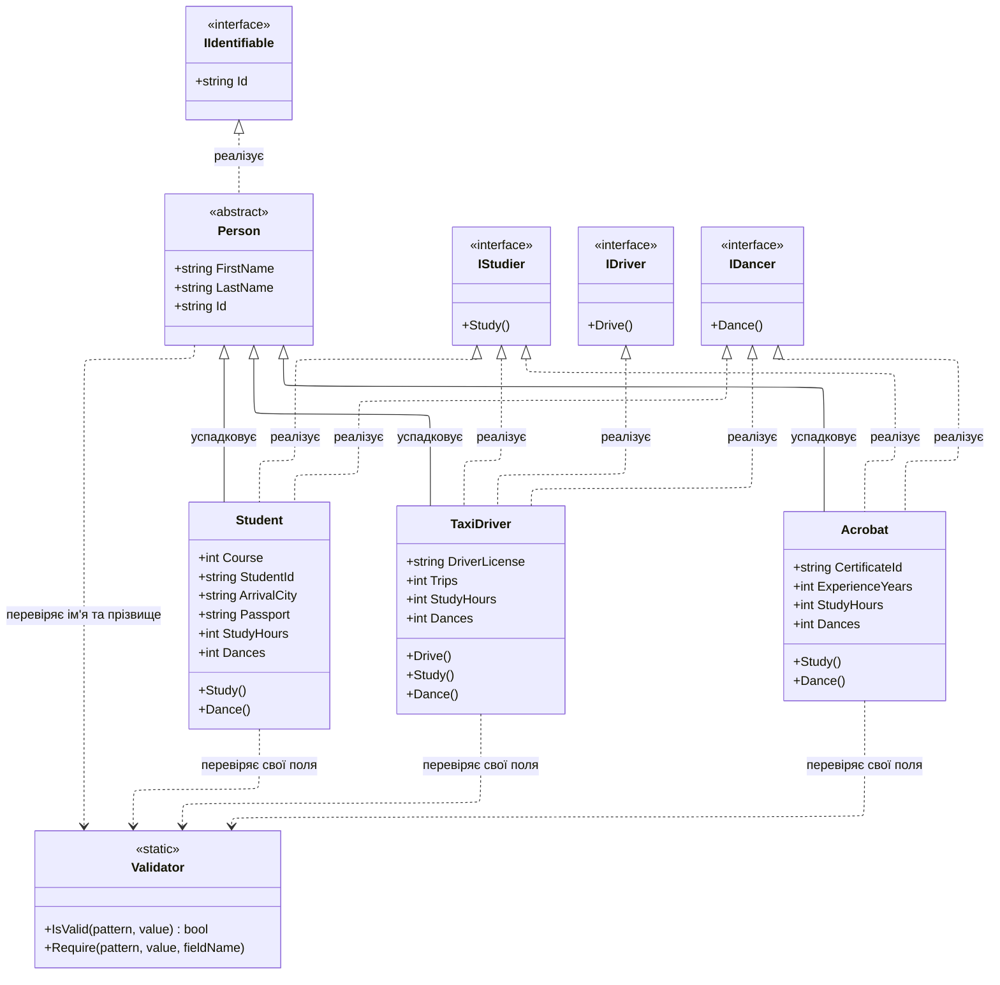
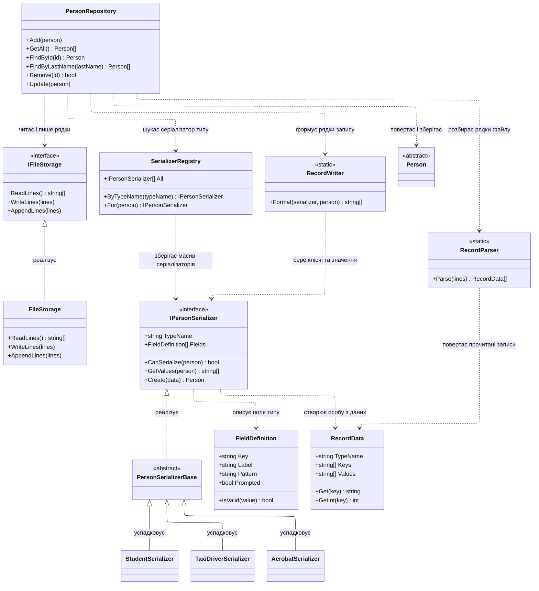
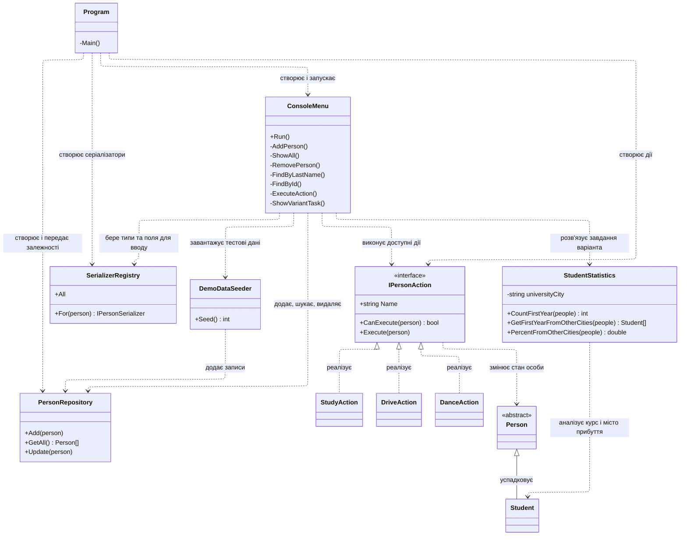
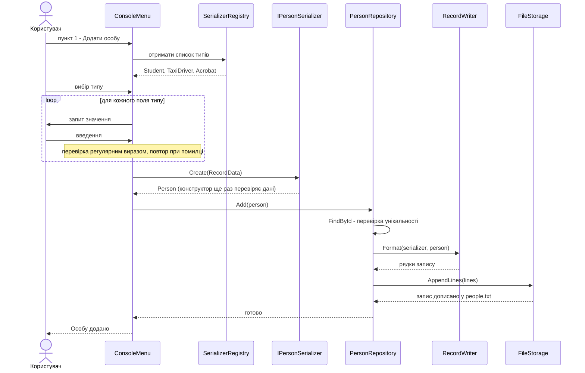
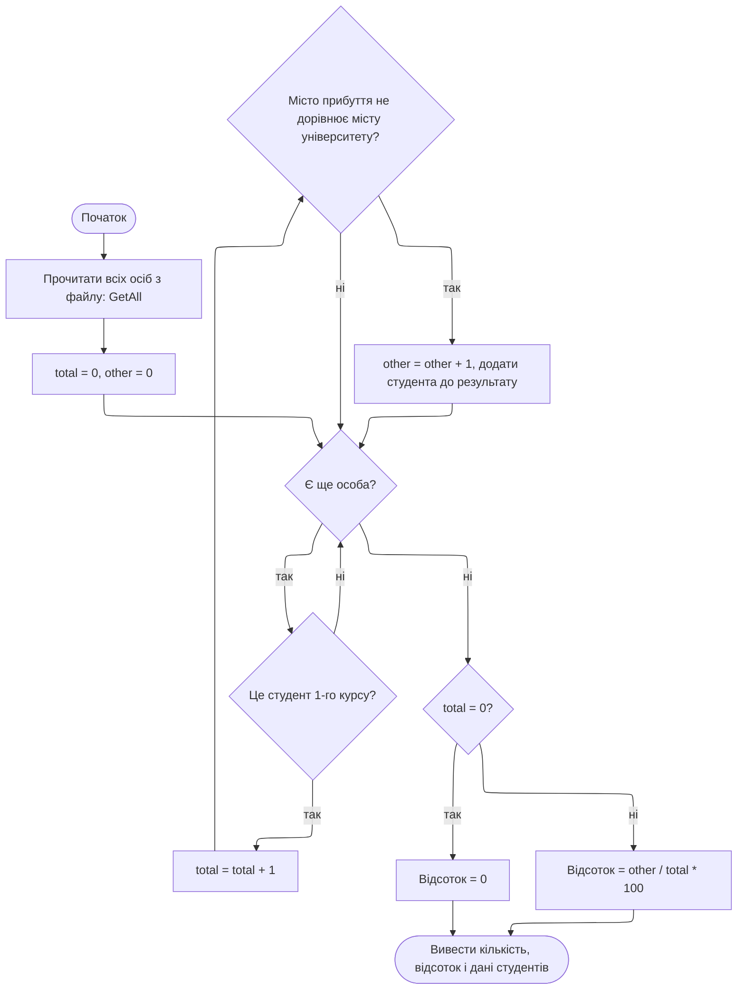
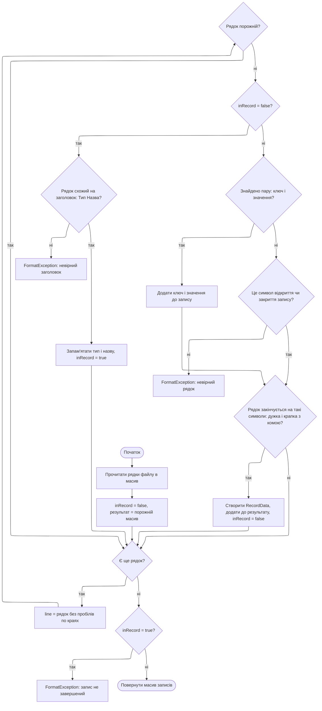

# Схеми до лабораторної роботи 3.1 - варіант 2

## 1. Діаграми класів

### 1.1. Предметна область: сутності та здібності

### 1.2. Збереження даних: репозиторій, сховище, серіалізація

Клас `FileStorage` та інтерфейс `IFileStorage` винесені в окремий проєкт `Lab1.Storage`. Усі інші класи належать проєкту `Lab1.App`.

### 1.3. Керування: меню, дії та завдання варіанта

## 2. Взаємодія об'єктів: додавання особи

## 3. Завдання варіанта: відсоток студентів 1-го курсу з інших міст

## 4. Читання файлу: розбір записів

